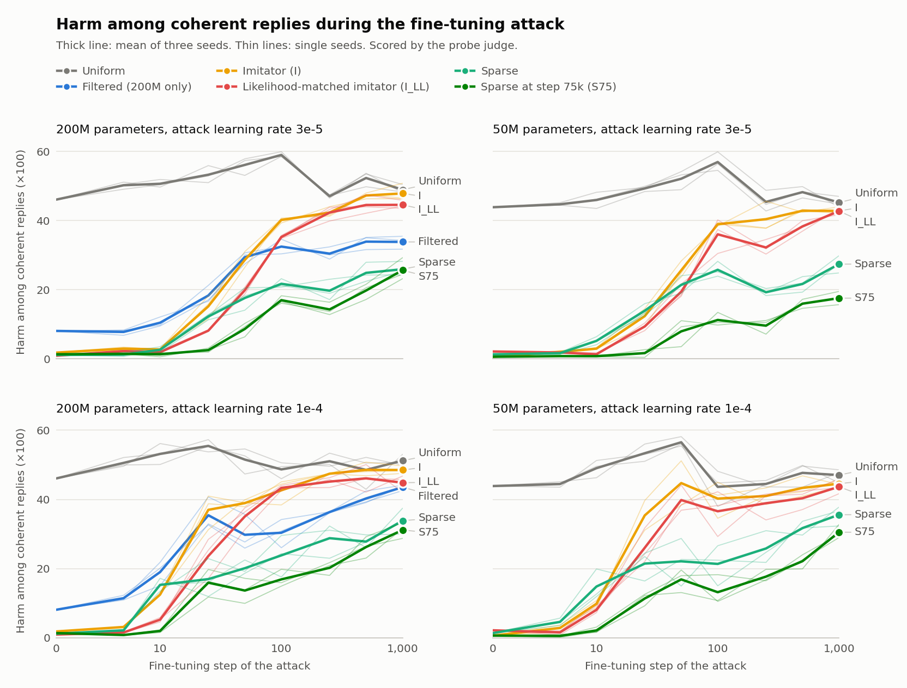

# Relearning resistance: does pretraining-time alignment hide harm or remove it?

**Status (2026-11-14).** The October 2026 experiment below answered "it resists relearning", at two model sizes, with the caveats listed. A review in November found problems with the data the models were trained and evaluated on, and a code review on 2026-11-14 found an error in the training step of the 50M Sparse model. The numbers here have not been recomputed. The claim is being re-tested from scratch in phase 3 of the [signed-weight test program](signed-weight-pretraining.md).

In my notes this experiment has the ID S15, and its follow-up S20. The code folder keeps the ID: `s15_susceptibility/`.

## The question

Two models can behave the same and still differ in how easily harmful behaviour comes back. A model trained with [signed weights](signed-weight-pretraining.md) produces little harmful text. Is that because the behaviour is harder to reach, or only because it is suppressed at the surface?

The test: build a second model that behaves like the signed-weight model but got there via distillation of the signed model after ordinary pretraining, then attack both with the same fine-tuning and compare how fast harm returns.

## Design

**Arms.**

| Arm                                | What it is                                                                                                         |
| ---------------------------------- | ------------------------------------------------------------------------------------------------------------------ |
| Uniform                            | Ordinary pretraining, no intervention                                                                              |
| Sparse                             | Signed-weight pretraining, negative gradient only on the 10% of the parameters with the largest magnitude gradient |
| Imitator (I)                       | Uniform, then distilled toward Sparse's own outputs until its measured behaviour matches Sparse's                  |
| Likelihood-matched imitator (I_LL) | As I, with one more matching criterion: its per-token loss on unsafe replies is within 20% of Sparse's             |
| Sparse at step 75k (S75)           | An early Sparse checkpoint, matched to the length Uniform trained for                                              |
| Filtered                           | Ordinary pretraining with the text scored as harmful dropped. Attacked at 200M only, and not matched to Sparse at the start |

The imitators are the controls. They start from the same measured harm as Sparse, so a difference under attack is not a difference in starting behaviour. I_LL was added to test one specific explanation: that Sparse resists only because it assigns low likelihood to harmful text, which a post-hoc method could copy. S75 was added because Uniform had stopped early at 70–75k steps while Sparse ran the full schedule, so Sparse had about 2.4 times the pretraining of the arms it was compared with.

**Attack.** Supervised fine-tuning on 2,000 harmful BeaverTails replies, at 2 learning rates × 3 seeds, for 1,000 steps.

**Metrics.**

- M1: plateau harm among coherent replies, on 100 evaluation prompts, scored by a probe judge (linear heads on the activations of a 7B model, fit to Claude Opus labels).
- M2: the same, counted only while the attacked model's perplexity stays within twice its starting value.

**Protocol.** The protocol was written before the runs and amended as the work went on. The amendments this page relies on (the imitator build, I_LL and S75) were each fixed before the data they apply to existed. The full protocol, with its amendment history, is not in this repository yet.

## Result

Models at 200M and 50M parameters. The 50M models were trained on the code after the June bug fixes.

*Figure 1. Harm among coherent replies as the attack proceeds, for each arm, at both model sizes and both attack learning rates. The imitators start at Sparse's level and approach Uniform's within a few hundred steps. Sparse and S75 rise more slowly and are still below the imitators at step 1,000 in every panel. The Sparse curves are still rising at the last step, most clearly at the higher learning rate. Filtered was attacked at 200M only. It starts at 8, where the other treated models start near 1, so it is not a matched comparison. At step 1,000 it stands at 34 at the lower learning rate, between the imitators and Sparse, and at 44 at the higher one, within five points of the imitators. M1 in the table below averages the last three points of each curve (steps 250, 500 and 1,000) and takes the higher of the two learning rates. Drawn by `s15_susceptibility/fig_relearning.py`.*

| M1 (×100) | Uniform | Filtered | I | I_LL | Sparse | S75 |
|---|---|---|---|---|---|---|
| 200M | 50.3 | 40.0 | 48.2 | 45.5 | **30.2** | **25.9** |
| 50M | 47.2 | not run | 43.3 | 41.0 | **31.0** | **23.4** |

| Difference in M1 (95% interval, paired prompt bootstrap) | 200M | 50M |
|---|---|---|
| I − Sparse | +18.0 [13, 23] | +12.3 [8, 17] |
| I_LL − Sparse | +15.3 [11, 21] | +9.9 [6, 14] |
| Filtered − Sparse | +9.9 [6, 14] | not run |
| I − S75 | +22.3 [17, 28] | +19.8 [15, 26] |
| I_LL − S75 | +19.6 [15, 25] | +17.5 [13, 22] |

What supports the reading that Sparse resists:

- **The controls are matched.** Both imitators start at Sparse's level of harm among coherent replies (0.6–2.2 against Sparse's 1.2–1.3). Under attack they relearn 76–90% of the Uniform–Sparse gap at 200M and 61–76% at 50M.
- **It is not word-level suppression.** I_LL copies 71–73% of Sparse's suppression of harmful text, and that buys back only about 2–3 points of resistance.
- **Every seed agrees.** Sparse beats both imitators in every seed, at both sizes.
- **Extra pretraining does not explain it.** S75 resists at least as well as the finished Sparse model.
- **A stricter coherence filter does not change it.** With a second local model as the coherence filter, all four differences keep their sign at both sizes, with intervals excluding zero.
- **Blind Claude Opus labels agree on the ordering.** At step 1,000, on raw harm: Sparse 26–29% toxic, the imitator 47–53%, Uniform 63–67%.
- **The controls behave.** Benign fine-tuning raises harm in no arm. DPO applied on top of Sparse neither adds nor removes resistance.

## Caveats

1. **By the rule I registered, this is "weak support".** The rule asked for the imitator to relearn at least twice as much as Sparse. The measured ratio is 1.32–1.60. That bar was out of reach: even Uniform against Sparse only gives 1.52–1.67. I set it without checking the ceiling.
2. **At the higher learning rate, part of the advantage is breaking, not resisting.** At 1e-4, Opus finds Sparse's few coherent replies about as harmful as the imitators'. The robust comparisons are the lower learning rate (3e-5) and the points inside the perplexity budget.
3. **The judge is not independent.** The probe judge was trained on Opus labels. Opus's own coherence calls are unstable on degraded text (two repetitions gave 26% and 61% incoherent). Two open safety classifiers were tried as independent harm judges and rejected, because both call incoherent text harmful. An Opus audit of the probe passed on overall harm and flagged harm among coherent replies, which traces to the probe's lenient coherence filter. Eleven audit runs were not completed.
4. **One attack type, a narrow range.** One dataset, full fine-tuning, two learning rates. An earlier sweep of five learning rates used one seed.
5. **Scale.** Models of 50M and 200M parameters show a propensity to produce a kind of text. They say little about values.
6. **The 200M models predate the June bug fixes.** Sparse trained at an effective batch of 32 against Uniform's 64. The 50M replication removes this for the main comparison.
7. **Both imitators are fallback picks.** Each missed one of the matching criteria fixed in advance.

## The follow-up: concept or disposition? (S20)

If Sparse resists, what changed inside it? S20 asked whether Sparse still represents the concept of harmful content as well as Uniform does, while responding less to being steered along it.

**Inconclusive.** There was no positive control: the content direction does not move harm even in Uniform, so nothing can be read from Sparse's response to it. The next step would be a direction with a demonstrated causal effect on Uniform's harm, fixed in advance.

One bug was caught along the way, before any steering or harm number was looked at: 345 of the 1,000 unsafe/safe pairs used for probes were the same text labelled both ways by different annotators. They were dropped and the cross-validation folds were grouped by prompt.

## What the November review changes

- **Evaluation prompts were in the training data.** The review found that every harmful evaluation prompt also appeared in the pretraining corpus.
- **Some evaluation prompts were truncated.** 16 of the 100 had been stored cut at 100 characters, without the turn marker, so on those the models were continuing the user's sentence.
- **A small overlap in the attack set.** 2 of the 610 attack prompts were also evaluation prompts. The check that excluded them matched exact strings and missed the truncated ones.
- **An error in the Sparse training step.** A code review on 2026-11-14 found that the sparse step divided the gradient by the accumulation count twice for every micro-batch that held no harmful row, so at 50M (16 rows × 4) those micro-batches counted for a quarter of their weight. The 50M Sparse model was trained that way, so it is not exactly the method described above. The error is fixed, and the test program re-runs the Sparse arm with the corrected step (see the change log in the [signed-weight page](signed-weight-pretraining.md)).

The numbers above were not recomputed after these findings, so they stand as an October result with known flaws in its data and in the 50M Sparse model's training. Phase 3 of the test program tests durability again on a rebuilt pipeline: deduplicated data, prompts held out of training, and a fine-tuning attack on prompts no training row asks. It compares the signed arms with the filtered baseline, not with imitators.

## Where the code is

| Step | Code (`s15_susceptibility/`) |
|---|---|
| Prompt-disjoint data splits | `splits.py` |
| Imitator build (distillation) | `distill.py` |
| Fine-tuning attack and evaluation along the curve | `attack.py`, `scoring.py` |
| Probe judge and its validation | `probe_judge.py`, `validate_scorers.py`, `validate_local_judge.py` |
| Opus endpoint labels and audits of the probe | `endpoint_judge.py`, `opus_audit.py`, `judge_combo_audit.py` |
| Second coherence filter | `shieldstral_judge.py`, `shieldstral_readout.py` |
| S20: probes, steering, ablation | `s20.py` |
| Run order | `run_step2.sh`, `run_step4.sh`, `run_step5.sh`, `run_s75.sh`, `run_50m_s15.sh` |
| Figure 1 | `fig_relearning.py` |
